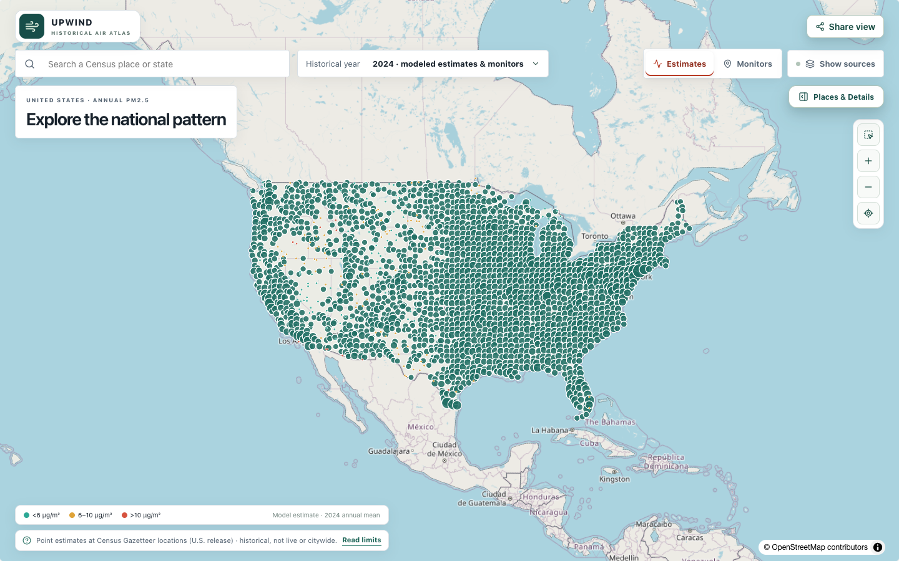
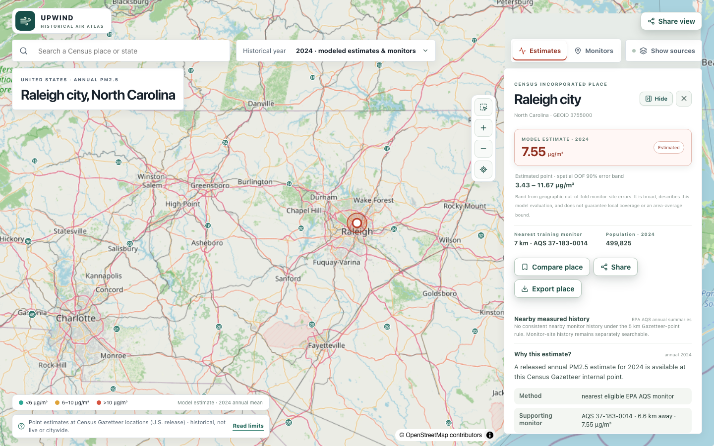
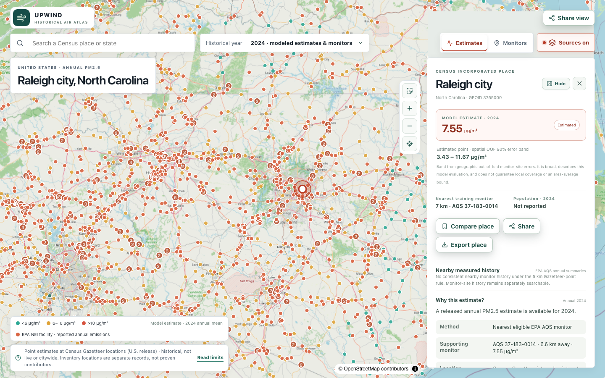
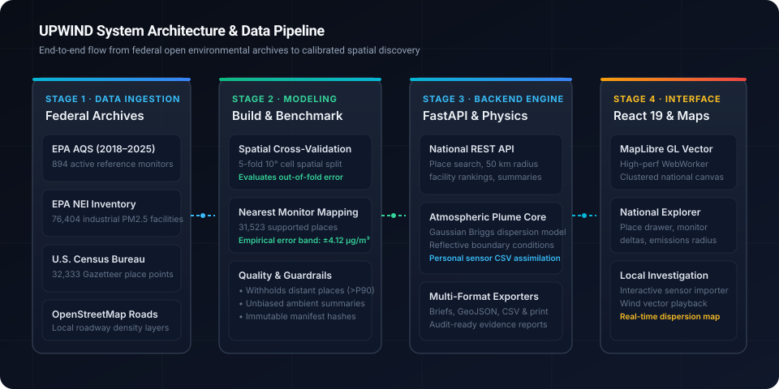

<div align="center">

# Upwind

**An open-source national atlas and atmospheric dispersion engine for historical U.S. fine particulate matter ($\text{PM}_{2.5}$) pollution.**

[](https://github.com/apandya55/Upwind/actions/workflows/ci.yml)
[](LICENSE)
[](pyproject.toml)
[](package.json)
[](frontend/package.json)
[](backend/upwind/api.py)

[Live Atlas](https://upwind.arnavpandya.com) · [Architecture](#system-architecture) · [Quick Start](#quick-start) · [Data Pipeline](#data-pipeline--reproduction) · [Methodology](https://github.com/apandya55/Upwind/blob/main/frontend/src/MethodologyPage.tsx) · [Contributing](CONTRIBUTING.md)

<br />



</div>

---

## Why Upwind?

Most public air-quality trackers show one of two extremes: real-time AQI dials or county-wide annual averages. County averages mask stark neighborhood differences, while raw federal environmental archives sit in gigabytes of multi-table spreadsheets that require dedicated GIS software to unpack.

Upwind takes federal environmental records and maps them into a fast, transparent, and place-by-place explorer across the contiguous United States:

1. **31,000+ U.S. Census Places**: Modeled annual $\text{PM}_{2.5}$ estimates grounded at Gazetteer internal points, bound by empirical $\pm 4.12\ \mu\text{g/m}^3$ 90% confidence intervals. Places beyond the 90th percentile distance from any reference monitor are explicitly withheld rather than guessed.
2. **894 Physical EPA Reference Monitors**: Official Air Quality System (AQS) stations showing multi-year historical readings, monitor design values, and sampling event history.
3. **76,400+ Industrial Facilities**: The full EPA National Emissions Inventory (NEI) with reported annual filterable and primary $\text{PM}_{2.5}$ tonnages.

> [!IMPORTANT]
> **Proximity does not equal causation.** Seeing an industrial facility near a town does not prove that factory caused local air readings. Upwind keeps physical monitor measurements, place estimates, and emissions inventories visually and conceptually separate so you can see where the data ends and where conjecture begins.

---

## What's in the App

### 1. National Explorer (`/`)
Search any U.S. Census town, borough, or city. Review its estimated annual $\text{PM}_{2.5}$ level, compare it with the nearest physical EPA reference monitor, inspect industrial emitters within a 50 km radius, and export community summary briefs as CSV, GeoJSON, or print-ready reports.

<div align="center">
  
  
</div>

### 2. Local Investigation Workspace (`/workspace`)
An in-browser laboratory for community science. Import custom sensor CSVs (PurpleAir, Sensirion, or custom hardware) alongside local weather logs (wind speed, wind direction, temperature) to run real-time Briggs Gaussian plume dispersion simulations and evaluate upwind source hypotheses.

### 3. Methodology & Scientific Notes (`/methodology`)
Complete documentation of our data intake criteria, nearest-monitor spatial assignment, 5-fold cross-validation results, and empirical error bands.

---

## System Architecture

Upwind is structured around a decoupled data pipeline, a high-performance backend, and a reactive vector-tile frontend:

<div align="center">
  
</div>

- **Frontend**: React 19, TypeScript, Vite, MapLibre GL with custom Web Workers for fluid pan-and-zoom across 76,000+ points without main-thread jank.
- **Backend**: FastAPI with strict Pydantic schemas, spatial radius indexing, and Briggs Gaussian plume dispersion kernels.
- **Data Engine**: Python pipelines compiling EPA AQS, EPA NEI, U.S. Census Gazetteer, and OpenStreetMap road layers into compact release artifacts.

---

## Quick Start

### Prerequisites
- **Python 3.12**
- **Node.js 22.12+** or **Node 24**
- Optional: [`uv`](https://github.com/astral-sh/uv) for fast environment installation

### Installation

```bash
# Clone the repository
git clone https://github.com/apandya55/Upwind.git
cd Upwind

# Install backend virtual environment & build frontend bundle
bash scripts/setup.sh
```

### Running Locally

```bash
# Launch FastAPI backend (:8000) and Vite frontend (:5173) concurrently
bash scripts/dev.sh
```

Open [http://localhost:5173](http://localhost:5173) in your browser.

---

## Data Pipeline & Reproduction

Upwind builds its national dataset reproducibly from official government publications:

```bash
# 1. Fetch raw EPA AQS annual summaries and Census Gazetteer files
.venv/bin/python scripts/acquire_aqs.py
.venv/bin/python scripts/acquire_osm_roads.py

# 2. Build the national release dataset (monitors, places, facilities, manifests)
.venv/bin/python scripts/build_national_dataset.py

# 3. Execute spatial cross-validation and benchmark models
.venv/bin/python scripts/evaluate_national_v3.py
```

### Upstream Sources

| Dataset | Source Agency | Timeframe | Records |
| :--- | :--- | :--- | :--- |
| **AQS Annual Summaries** | U.S. EPA | 2018–2024 (provisional 2025) | 894 active eligible stations |
| **National Emissions Inventory (NEI)** | U.S. EPA | 2023 | 76,404 mapped facility records |
| **Gazetteer Place Files** | U.S. Census Bureau | 2024 | 32,333 places (internal points) |
| **Road Density Context** | OpenStreetMap | 2024–2026 snapshot | Major corridors across focus areas |

---

## Verification & Testing

The repository maintains an extensive test suite verifying mathematical kernels, boundary conditions, edge cases, and API contracts:

```bash
# Run all 228 backend tests
.venv/bin/python -m pytest backend/tests

# Typecheck and compile frontend bundle
cd frontend
npm run build

# Run Playwright end-to-end browser tests
npx playwright test
```

---

## Scientific Boundaries & Limitations

- **Annual retrospective view**: Upwind is designed for research, baseline comparisons, and historical investigations. It is not an active wildfire tracking tool or real-time emergency alert system.
- **Point-level approximations**: Census estimates represent Gazetteer internal points, not citywide averages. In geographically vast municipalities, conditions vary substantially across town limits.
- **Zero data fabrication**: If a place is located beyond the 90th percentile distance of reference monitors ($> 75\ \text{km}$), Upwind withholds the estimate rather than inventing a number.

---

## Contributing

Contributions, bug reports, and research discussions are welcome! Please read our [Contributing Guide](CONTRIBUTING.md) and [Code of Conduct](CODE_OF_CONDUCT.md) before opening a pull request.

---

## Citation

If you use Upwind in academic work, policy research, or environmental analyses, please cite it using:

```bibtex
@software{pandya2026upwind,
  author = {Pandya, Arnav},
  title = {Upwind: An Open-Source National Atlas for Historical Air Pollution Exploration},
  year = {2026},
  url = {https://github.com/apandya55/Upwind},
  license = {Apache-2.0}
}
```

See [CITATION.cff](CITATION.cff) for complete citation metadata.

---

## License

Source code is released under the [Apache-2.0 License](LICENSE). Upstream public data records remain subject to their respective U.S. government open-data terms.
