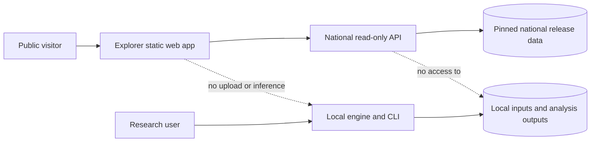

# ADR: UPWIND release architecture and product boundaries

- **Status:** Accepted for the first public release; migration work remains phased
- **Date:** 2026-10-29
- **Decision owners:** UPWIND maintainers

## Context

UPWIND contains two products with different users, data boundaries, and release
risks:

1. The **local engine** lets researchers run the Python model against their own
   measurements and weather data. Raw imports, UTC transformations, row
   origins, instrument metadata, provenance, and analysis outputs remain on the
   user's machine.
2. The **National Explorer** is a public atlas backed by a generated national
   release. It serves historical Census point estimates, EPA monitor summaries,
   and EPA inventory records as separate evidence classes.

The National Explorer's nearest-monitor place estimate is a separate deployed
product from the experimental plume engine. The public service must not accept
uploads, expose local investigation storage, or run arbitrary user inference.

## Decision

Keep one Git repository for the first public release. Organize it as a modular
monorepo with explicit surfaces and contracts:

```text
apps/explorer-web/       React/Vite public National Explorer
services/explorer-api/   read-only national API and readiness endpoints
packages/upwind-engine/  installable local Python engine and CLI
packages/contracts/      versioned API, export, and release schemas
data-pipeline/national/  source acquisition and national release generation
deploy/                  container, Caddy, and host deployment definitions
docs/                    science, provenance, operations, and release records
```

The current paths may remain in place during the first migration, provided the
public and local build surfaces are explicit. The public build should exclude
the local upload/workspace UI; the local build may retain it. Both surfaces
must preserve the same provenance and evidence distinctions.

The Python distribution exposes local numerical dependencies through the
`engine` optional extra. The public API function installs the runtime lock only;
it does not install NumPy, SciPy, pandas, pyproj, pytest, or the local engine's
scientific stack. A clean Python 3.12 installation of `.[engine]` was verified
with `upwind --help`; local users install that extra to use the CLI and engine.

## Runtime boundary



The public API allows bounded GET/HEAD national reads plus health/readiness
checks. Exact-origin OPTIONS preflight is enabled only for configured CORS
origins and GET/HEAD requests. It reads an immutable generated release bundle
in the hosted function and must not expose a write-capable API. Local engine commands may read user files and write local
SQLite/JSON/report outputs, but those paths are not part of the public service.

The selected hosted option is Vercel for both surfaces: one static Explorer
project rooted at `frontend/` and one read-only Python API project rooted at
the repository. Set `VITE_API_BASE_URL` to the API project's public HTTPS
origin and `UPWIND_CORS_ORIGINS` to the exact Explorer origin(s). Do not expose
a browser-side API secret, enable broad `*` CORS, or point Vercel functions at
the local engine. The API build retrieves an approved immutable release bundle
from private Vercel Blob or uses the explicitly staged `deployment-data/`
directory; it runs in public read-only mode. The Docker/Caddy stack remains
available for private staging and rollback rehearsal, but it is not the public
API target.

## Phased migration

### Phase 1: first public release

- Keep one repository. Version the software/API package (`0.1.0`) separately
  from the National Explorer data/model release (`0.3.0`); preserve the local
  engine's model/protocol identity independently.
- Add an explicit public/local build surface flag and keep public routes
  read-only.
- Publish the local engine as research software with its model/protocol
  identifiers and scientific limitations.
- Version the national release manifest and API/export schemas.

### Phase 2: package boundaries

- Move engine modules, CLI, local import/export code, and scientific tests under
  `packages/upwind-engine`.
- Move Explorer routes, national release readers, and public API tests under
  `apps/` and `services/`.
- Extract shared response/export types into `packages/contracts`.
- Keep data acquisition and release generation separate from runtime serving.

### Phase 3: optional repository split

Split into `upwind-engine` and `upwind-explorer` repositories only after the
package and contract boundaries are stable. Release the engine independently
from the national data/web release. Do not split earlier solely to create the
appearance of separation; shared contracts, tests, and release provenance are
still evolving.

## Acceptance and release gates

The first public release is acceptable only when all of the following are
recorded:

- Python 3.12 full backend test pass; frontend production build pass; focused
  Playwright workflows pass.
- Clean national data build and `verify_release_bundle.py` pass, with source
  URLs, vintages, hashes, counts, and OSM attribution retained.
- Public build excludes local upload/workspace behavior, or those routes are
  explicitly documented as local-only and cannot write through the public API.
- Public mode permits bounded national GET/HEAD routes, health/readiness, and
  configured exact-origin preflight only;
  write, demo, import, analysis, and local workspace routes return 404.
- Vercel function build, immutable data bundle, `/api/ready`, HTTPS smoke tests,
  export checks, exact-origin CORS, and public route-boundary checks pass in a
  hosted preview. Optional Compose/Caddy staging remains a rollback rehearsal,
  not evidence of Vercel readiness.
- The deployment has an immutable function/data identity, logs, health alerts,
  backup/restore procedure, rollback procedure, and an edge rate limit. The
  in-process limiter alone is not an operations control.
- README, methodology, exports, and release notes state that Explorer values
  are historical Census point estimates supported by monitor evidence, not
  place averages, current conditions, exposure, source attribution, or field
  validation.

## External prerequisites and unresolved items

- The owner selected **Apache-2.0** for project source. The actual `LICENSE`
  and `CITATION.cff` files are included in the repository. They license the
  project source; they do not override upstream EPA, Census, or OpenStreetMap
  data terms.
- The owner approved public hosting of the generated EPA/Census/OSM bundle
  with required attribution. OSM attribution and ODbL obligations remain
  required; this decision is not an independent legal determination.
- Vercel project domains, monitoring/alerting path, backup location, and
  rollback owner must be configured before calling the service production
  deployed.
- The public OSM tile service remains an external best-effort dependency with no
  project service-level agreement.
- Scientific evidence remains synthetic/development evidence for the engine.
  This architecture does not establish field accuracy, calibration, source
  responsibility, regulatory attribution, partner adoption, or operational
  readiness.
