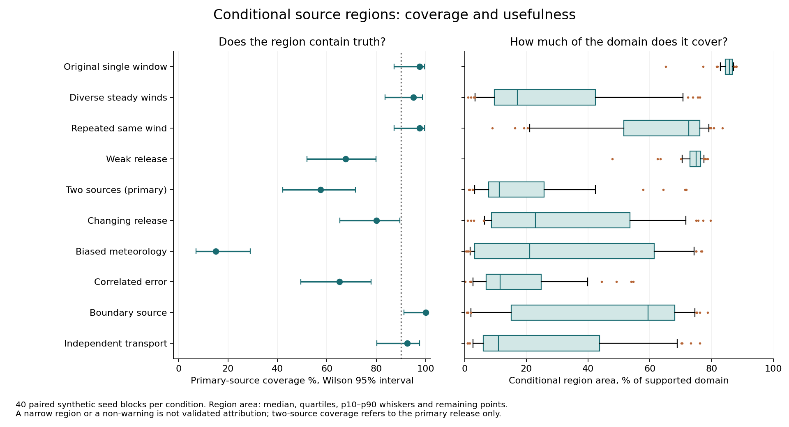

# Research results and capability decision

Model **plume-campaign-0.4.0**, protocol **UW-RESEARCH-2026-02**. Synthetic evidence only. The redesigned campaign engine materially improves localization in a specifically supported synthetic measurement design, and the prediction planner is tested on actual withheld outcomes. **It is not reliable enough for organizational source attribution, enforcement, compliance or allegations.** Changed release, biased meteorology and transport outside the assumed model can remain confidently wrong; the warning screen does not reliably protect those decisions.

The supported-control campaign has median MAP error **22.9 m** against a no-data centroid median **164.7 m**, with **38/40** conditional-region coverage and mean region **26.9%** of the unchanged search domain. Its fixed interpretive rule accepts **25/40**, with **2** accepted primary-location region misses. These are 40 held-out synthetic seed blocks under compatible transport, not a field accuracy guarantee.

The control's MAP error 90th percentile is **159.0 m** (maximum **354.0 m**); the median is not an accuracy bound. In the biased-weather challenge, **18/18 accepted regions miss** and no warning is raised. The new prediction planner does not consistently outperform random placement across conditions. These failures prevent a trusted attribution or general recommendation claim.

On the independent advection/transverse-diffusion challenge, coverage is **37/40** and **3/27** accepted regions miss. On the original low-information single-window population, mean region remains **84.9%**, with **0/40** accepted. The new data intervention does not demonstrate that the old measurements suddenly identify sources.

## What changed and why

[Root-cause evidence](RESEARCH_ROOT_CAUSES.md), [equations/code/owner handover](RESEARCH_IMPLEMENTATION.md), [scientific meaning](SCIENCE.md) and [commands/provenance](RESEARCH_REPRODUCTION.md) describe the implemented system. Main changes: explicit separately steady campaign periods with shared fixed source/constant release; per-period backgrounds with persistent instrument bias; declared weather uncertainty/heights; four-node spatial integration; exact positive-strength predictive density/sampling; joint withheld-sensor/period contrasts; global free-nuisance profiles; optional deterministic concentration-prediction design. No new runtime scientific dependency.

Four periods are **extra collected data**, with different winds and extra collection time. The source rectangle[-450,-80]×[-220,220]m, release strength 18000–36000 µg/s (weak 150–450), six existing monitors,12 feasible candidates,250 cost units and two added instruments are retained. The rectangle is never centered or shrunk around truth. The original population remains separate. User-declared 3° met uncertainty is simulated study metadata, not inferred field calibration;25° bias intentionally violates it.

## Fresh final source results

Each condition has 40 paired seed blocks. Wilson 95% intervals accompany coverage; area is mean percent of the 162,800 m² supported domain. MAP/mean/centroid errors are medians in metres. Two-source coverage/error below refer to the **primary** release only, not correct identification of both sources. Background-only has no location truth; its location fields are deliberately absent. Unsupported inputs stay in the denominator and refuse rather than create data.

| Condition | Fit/refuse | MAP / mean / centroid m | 90% coverage (95% CI) | Mean area % | Accepted / misses | Warnings |
|---|---|---|---|---|---|---|
| single_window_original | 40/0 | 188.8 / 86.7 / 86.6 | 39/40 (87–100%) | 84.9 | 0 / 0 | 0/40 |
| informative_campaign | 40/0 | 22.9 / 59.1 / 164.7 | 38/40 (83–99%) | 26.9 | 25 / 2 | 0/40 |
| same_wind_repetition | 40/0 | 160.3 / 126.9 / 164.7 | 39/40 (87–100%) | 61.1 | 7 / 0 | 0/40 |
| weak_campaign | 40/0 | 215.9 / 159.1 / 164.7 | 27/40 (52–80%) | 73.7 | 0 / 0 | 0/40 |
| background_campaign | 40/0 | — / — / — | — | 72.0 | 0 / 0 | 0/40 |
| two_sources_campaign | 40/0 | 103.1 / 102.3 / 164.7 | 23/40 (42–71%) | 19.9 | 30 / 15 | 1/40 |
| changing_release_campaign | 40/0 | 70.0 / 86.6 / 164.7 | 32/40 (65–90%) | 31.1 | 20 / 7 | 1/40 |
| biased_met_campaign | 40/0 | 179.9 / 158.5 / 164.7 | 6/40 (7–29%) | 30.4 | 18 / 18 | 0/40 |
| correlated_campaign | 40/0 | 95.2 / 81.0 / 164.7 | 26/40 (50–78%) | 17.2 | 9 / 3 | 27/40 |
| boundary_campaign | 40/0 | 34.3 / 139.4 / 227.2 | 40/40 (91–100%) | 46.9 | 6 / 0 | 2/40 |
| independent_transport | 40/0 | 46.2 / 63.8 / 164.7 | 37/40 (80–97%) | 23.6 | 27 / 3 | 1/40 |
| unsupported_campaign | 0/40 | — / — / — | — | — | 0 / 0 | 0/0 |

Coverage and area must be read together: a large covering region can be unhelpful, and a small wrong region can be dangerous. The rule remains P(source)≥.9, region<50%domain and no warning, fixed before final. An accepted mismatch case is not removed from the analysis. The label is research-only and uncalibrated.

## Presence, wrongly sharp results and held-sensor prediction

A source-presence Brier score measures the binary simulated presence indicator under this artificially chosen case mix. It does not calibrate facility responsibility or location. A miss means P(source)<.5; false-source alarm means P(source)>.9 when Q=0. A wrongly sharp region misses the primary truth while covering<25%domain and P(source)>.9. Concentration metrics hold out a whole sensor; rows within a world are not counted as independent campaigns. NLPD is mean negative marginal log density, not a product likelihood for correlated observations. New intervals use 2048 scrambled Sobol draws from the exact truncated-strength predictive distribution.

| Condition | Presence Brier mean | Miss / false alarm | Wrongly sharp | Held-sensor RMSE median µg/m³ | NLPD median | 90% interval coverage / width median |
|---|---|---|---|---|---|---|
| single_window_original | 0.274 | 31/40 ; 0/0 | 0/40 | 1.490 | 1.926 | 100.0% / 6.93 |
| informative_campaign | 0.108 | 7/40 ; 0/0 | 2/40 | 1.445 | 1.894 | 100.0% / 6.93 |
| same_wind_repetition | 0.235 | 25/40 ; 0/0 | 0/40 | 1.397 | 1.888 | 100.0% / 6.89 |
| weak_campaign | 0.547 | 40/40 ; 0/0 | 0/40 | 1.557 | 1.927 | 100.0% / 6.83 |
| background_campaign | 0.083 | 0/0 ; 0/40 | 0/40 | 1.406 | 1.863 | 100.0% / 6.80 |
| two_sources_campaign | 0.050 | 3/40 ; 0/0 | 16/40 | 1.520 | 1.955 | 100.0% / 6.98 |
| changing_release_campaign | 0.129 | 8/40 ; 0/0 | 8/40 | 1.661 | 1.983 | 100.0% / 6.92 |
| biased_met_campaign | 0.183 | 13/40 ; 0/0 | 18/40 | 1.599 | 1.959 | 100.0% / 6.91 |
| correlated_campaign | 0.052 | 3/40 ; 0/0 | 12/40 | 2.796 | 2.530 | 81.2% / 7.02 |
| boundary_campaign | 0.307 | 23/40 ; 0/0 | 0/40 | 1.617 | 1.944 | 100.0% / 6.84 |
| independent_transport | 0.107 | 9/40 ; 0/0 | 3/40 | 1.495 | 1.907 | 100.0% / 6.94 |
| unsupported_campaign | — | 0/0 ; 0/0 | 0/0 | — | — | —% / — |

The warning counts above include healthy controls (false warnings) and mismatch challenges (detections). A non-warning is not proof that source count, weather or release history is correct. Several failures are observationally similar under this layout. The full raw records expose unavailable checks and which sensor/period blocks were actually screened.

## Realized planner results

First 12 final seed blocks in four conditions,25 methods per world: prediction-risk, current information, spread, wind, old 0.3 planner and 20 random seeds. All choices are locked before candidate outcomes are generated. Refits share the same realized outcomes at selected sites; the separate target instruments' outcomes stay withheld. Target geometry is known design information. All methods share costs, access, power, weather, equipment and timestamp. This is a retrospective hypothetical measurement comparison, not a future deployment/forecast guarantee.

Positive advantage means lower held-target RMSE than the mean of 20 random placements in that same world. Intervals bootstrap 12 paired seed blocks,5000 resamples/RNG 90211; they remain imprecise. Campaign inputs are unsupported by 0.3: its empty/no-update records are **not applicable**, not a fair campaign planner win/loss. In the original single-window condition its chosen placements are applicable.

| Condition | Method | Worlds | Post RMSE mean | Advantage mean [95%CI] µg/m³ | Loses to random | Worst advantage | Mean cost |
|---|---|---|---|---|---|---|---|
| biased_met_campaign | prediction_risk | 12 | 1.725 | 0.231 [0.019,0.593] | 2/12 | -0.100 | 215.0 |
| biased_met_campaign | information | 12 | 1.729 | 0.227 [0.006,0.602] | 3/12 | -0.094 | 193.3 |
| biased_met_campaign | spread | 12 | 2.011 | -0.055 [-0.178,0.027] | 6/12 | -0.685 | 220.0 |
| biased_met_campaign | wind | 12 | 1.901 | 0.055 [-0.011,0.135] | 5/12 | -0.081 | 190.0 |
| informative_campaign | prediction_risk | 12 | 1.517 | 0.199 [-0.050,0.637] | 5/12 | -0.116 | 210.8 |
| informative_campaign | information | 12 | 1.503 | 0.212 [-0.026,0.644] | 4/12 | -0.124 | 180.8 |
| informative_campaign | spread | 12 | 1.834 | -0.118 [-0.455,0.076] | 4/12 | -1.871 | 220.0 |
| informative_campaign | wind | 12 | 1.518 | 0.198 [-0.049,0.641] | 6/12 | -0.135 | 203.3 |
| single_window_original | prediction_risk | 12 | 1.563 | -0.011 [-0.096,0.068] | 7/12 | -0.333 | 208.3 |
| single_window_original | information | 12 | 1.500 | 0.052 [-0.037,0.135] | 5/12 | -0.254 | 212.5 |
| single_window_original | spread | 12 | 1.522 | 0.030 [-0.079,0.146] | 6/12 | -0.264 | 207.5 |
| single_window_original | wind | 12 | 1.601 | -0.049 [-0.118,0.015] | 8/12 | -0.320 | 215.0 |
| single_window_original | baseline_0.3_planner | 12 | 1.500 | 0.052 [-0.036,0.136] | 5/12 | -0.254 | 212.5 |
| weak_campaign | prediction_risk | 12 | 1.603 | -0.013 [-0.057,0.030] | 7/12 | -0.155 | 213.3 |
| weak_campaign | information | 12 | 1.615 | -0.025 [-0.055,-0.000] | 8/12 | -0.150 | 206.7 |
| weak_campaign | spread | 12 | 1.555 | 0.035 [-0.009,0.085] | 5/12 | -0.076 | 220.0 |
| weak_campaign | wind | 12 | 1.625 | -0.035 [-0.063,-0.008] | 7/12 | -0.133 | 216.7 |

Source-localization outcomes are separate from prediction benefit. A positive MAP advantage below means lower primary-source MAP error than random; it is not the prediction objective.

| Condition | Method | MAP advantage m | Paired 95%CI m | Post mean area % | Post coverage |
|---|---|---|---|---|---|
| biased_met_campaign | prediction_risk | 1.3 | [0.0,2.8] | 20.2 | 1/12 |
| biased_met_campaign | information | 1.3 | [0.0,2.8] | 19.4 | 1/12 |
| biased_met_campaign | spread | -0.3 | [-1.6,0.7] | 21.3 | 1/12 |
| biased_met_campaign | wind | 1.3 | [0.0,2.8] | 19.3 | 1/12 |
| informative_campaign | prediction_risk | -3.3 | [-11.8,3.5] | 19.5 | 12/12 |
| informative_campaign | information | -16.3 | [-47.9,3.7] | 19.4 | 12/12 |
| informative_campaign | spread | 4.4 | [-0.3,10.7] | 21.2 | 12/12 |
| informative_campaign | wind | 4.4 | [-0.3,10.7] | 20.0 | 12/12 |
| single_window_original | prediction_risk | 16.0 | [-37.8,68.3] | 68.9 | 10/12 |
| single_window_original | information | 14.9 | [-17.7,48.2] | 67.8 | 10/12 |
| single_window_original | spread | 31.7 | [-4.8,65.3] | 78.0 | 11/12 |
| single_window_original | wind | -27.7 | [-51.9,-3.8] | 83.4 | 10/12 |
| single_window_original | baseline_0.3_planner | 14.9 | [-17.7,48.2] | 67.8 | 10/12 |
| weak_campaign | prediction_risk | -3.0 | [-26.6,20.2] | 74.9 | 7/12 |
| weak_campaign | information | 14.0 | [-21.1,57.9] | 74.7 | 7/12 |
| weak_campaign | spread | 2.8 | [-17.0,25.0] | 74.8 | 8/12 |
| weak_campaign | wind | 2.0 | [-20.1,25.6] | 74.5 | 8/12 |

Prediction-risk's mean RMSE-advantage interval is entirely positive in: **biased_met_campaign**. Other intervals cross zero or indicate loss; report them rather than selecting only successful worlds. This is a specific synthetic concentration-prediction finding, not a universal planner or attribution guarantee. Spread and random remain explicit practical alternatives.

## Development ablations and original data

The 12-seed paired material ablation keeps source/Q/domain/monitor/candidate geometry fixed. First-window 0.3 also retains that engine's broad 20° met assumption, so it is a full prior-version comparison; first-window 0.4 uses declared 3°. Do not attribute that entire difference to a new optimizer. Noiseless controls access evaluator truth only diagnostically; production never receives it.

| Data design | Ablation | n | Median MAP m | Mean area % | Covered |
|---|---|---|---|---|---|
| informative_campaign | broad_met | 12 | 20.9 | 21.1 | 11 |
| informative_campaign | dense 10 m | 12 | 28.2 | 14.4 | 12 |
| informative_campaign | first_window | 12 | 166.9 | 59.5 | 11 |
| informative_campaign | first_window_0.3 | 12 | 139.2 | 74.9 | 11 |
| informative_campaign | four_windows | 12 | 22.6 | 14.8 | 12 |
| informative_campaign | midpoint | 12 | 23.6 | 14.3 | 11 |
| same_wind_repetition | broad_met | 12 | 59.7 | 47.4 | 12 |
| same_wind_repetition | dense 10 m | 12 | 59.8 | 26.4 | 12 |
| same_wind_repetition | first_window | 12 | 47.7 | 31.8 | 12 |
| same_wind_repetition | first_window_0.3 | 12 | 76.8 | 52.9 | 12 |
| same_wind_repetition | four_windows | 12 | 52.5 | 26.9 | 12 |
| same_wind_repetition | midpoint | 12 | 49.0 | 26.4 | 12 |

The following 400 previously inspected original-development worlds compare 0.3 and 0.4 with the same original single-window data/default assumptions. They are a regression population, not a fresh holdout. No data-intervention benefit is claimed here.

| Original condition | Model | Fit/refuse | Median MAP m | Mean area % | Primary coverage | Warnings |
|---|---|---|---|---|---|---|
| original-background_only | baseline-0.3.0 | 40/0 | — | 83.0 | 0/0 | 0 |
| original-background_only | plume-campaign-0.4.0 | 40/0 | — | 83.0 | 0/0 | 0 |
| original-boundary | baseline-0.3.0 | 40/0 | 205.5 | 73.2 | 38/40 | 0 |
| original-boundary | plume-campaign-0.4.0 | 40/0 | 205.5 | 73.2 | 38/40 | 0 |
| original-correlated_errors | baseline-0.3.0 | 40/0 | 144.4 | 60.9 | 33/40 | 1 |
| original-correlated_errors | plume-campaign-0.4.0 | 40/0 | 144.4 | 60.9 | 33/40 | 2 |
| original-direction_bias | baseline-0.3.0 | 40/0 | 230.2 | 80.5 | 22/40 | 0 |
| original-direction_bias | plume-campaign-0.4.0 | 40/0 | 230.2 | 80.5 | 22/40 | 0 |
| original-episodic | baseline-0.3.0 | 40/0 | 184.2 | 80.3 | 31/40 | 0 |
| original-episodic | plume-campaign-0.4.0 | 40/0 | 184.2 | 80.3 | 31/40 | 0 |
| original-missingness | baseline-0.3.0 | 40/0 | 142.3 | 81.0 | 38/40 | 0 |
| original-missingness | plume-campaign-0.4.0 | 40/0 | 142.3 | 81.0 | 38/40 | 0 |
| original-strong_signal | baseline-0.3.0 | 40/0 | 136.2 | 70.1 | 39/40 | 0 |
| original-strong_signal | plume-campaign-0.4.0 | 40/0 | 136.2 | 70.1 | 39/40 | 0 |
| original-two_sources | baseline-0.3.0 | 40/0 | 128.9 | 60.7 | 31/40 | 0 |
| original-two_sources | plume-campaign-0.4.0 | 40/0 | 128.9 | 60.7 | 31/40 | 0 |
| original-unsupported_weather | baseline-0.3.0 | 0/40 | — | — | 0/0 | 0 |
| original-unsupported_weather | plume-campaign-0.4.0 | 0/40 | — | — | 0/0 | 0 |
| original-weak_signal | baseline-0.3.0 | 40/0 | 225.2 | 82.6 | 25/40 | 0 |
| original-weak_signal | plume-campaign-0.4.0 | 40/0 | 225.2 | 82.6 | 25/40 | 0 |

## Calibration and sensitivity

Calibration used 24 distinct seed blocks/layout/wind and an independent stretched-profile mechanism. It was diagnostic: no posterior calibration transform or threshold was fitted, and no policy changed to rescue acceptance. The full calibration was repeated after pre-final valid-input/metadata corrections; its unchanged numerical results and source hashes are verified separately. Descriptive calibration acceptance/coverage tradeoffs are in `calibration-tradeoffs.json`, by condition. No final truth selected a threshold.

Final perturbations use the first four seeds/condition: reverse input lists,+3°wind,+5 µg/m³ background,+2 µg/m³ one sensor,10 m/48-axis grid. Plan overlap is tested on the first seed with the prediction objective. These are sensitivity probes, not a guarantee that changed physical inputs leave an answer unchanged.

| Perturbation | Fits | MAP shift median m | MAP shift max m | Mean shift max m | Mean plan Jaccard |
|---|---|---|---|---|---|
| reverse_rows | 44 | 0.0 | 0.0 | 0.0 | 1.00 |
| wind_plus3 | 44 | 27.3 | 465.4 | 105.3 | 1.00 |
| background_plus5 | 44 | 0.0 | 0.0 | 0.7 | 1.00 |
| one_sensor_plus2 | 44 | 19.5 | 441.2 | 43.6 | 0.88 |
| grid 10 m | 44 | 10.2 | 222.9 | 1.6 | 1.00 |

[Standalone PDF](../evaluations/research/final/figures/source-coverage-area.pdf) · [Planner outcome chart](../evaluations/research/final/figures/planner-realized-outcomes.png) · [Ablation chart](../evaluations/research/final/figures/development-ablations.png). SVG and PDF exports are retained alongside each PNG.

Grid-refinement source metrics use fresh direct fits. The original perturbation planner reused a cached baseline for the identical payload under a diagnostic CONFIG mutation; its grid plan-overlap field is invalid. A separate fresh-cache paired check, `grid-plan-check`, supplies the corrected overlap above for all three splits. Production configuration is fixed; no production/model change was made. All other perturbation overlap fields use their changed input payloads.

A separate development 480-reading campaign compares 64/128 selected rows with all 480 (limit 512). This changes sampling only, keeping domain, Q, geometry and declared met fixed; it does not pretend the 10,000-row resource import was fully inverted. A subset can change a mode even when its mean remains nearby.

| Seed | Limit | Fitted | MAP error m | Region area % | Covered | Location-mass TV vs full | Mean shift vs full m |
|---|---|---|---|---|---|---|---|
| 710000 | 64 | 64 | 10.7 | 0.7 | True | 0.346 | 6.7 |
| 710000 | 128 | 128 | 9.1 | 0.7 | True | 0.052 | 0.9 |
| 710000 | 512 | 480 | 9.1 | 0.7 | True | 0.000 | 0.0 |
| 710001 | 64 | 64 | 19.2 | 7.1 | True | 0.435 | 4.5 |
| 710001 | 128 | 128 | 113.7 | 7.8 | True | 0.210 | 1.9 |
| 710001 | 512 | 480 | 129.0 | 6.9 | True | 0.000 | 0.0 |
| 710002 | 64 | 64 | 25.9 | 15.1 | True | 0.251 | 11.2 |
| 710002 | 128 | 128 | 25.9 | 12.8 | True | 0.133 | 13.0 |
| 710002 | 512 | 480 | 21.6 | 11.9 | True | 0.000 | 0.0 |

## Engineering and audit

Final scientific run:480 condition-worlds/40 seed blocks,960 old/new outcomes,1200 follow-ups; unsupported 0.3 campaigns remain explicit refusals. Current 0.4 fits 440 cases and refuses 40 unsupported-weather cases; old 0.3 fits 40 single-window cases and refuses 440 campaign inputs. These are 960 outcomes, not 960 successful fits. All generated cases, ambiguous outputs and failures stay in raw records. Final hashes before/after match the predeclared final source freeze. Baseline reproduction matches 800/864/108 original 0.3 outputs exactly excluding timings. Current verification:99 pytest tests, seven Chromium workflows, production typecheck/build and RuffF 401/F821. These checks verify software, not field science.

Fresh-child resource limits:60 seconds,2 GiB address space, one BLAS thread. Every probe loads 10,000 measurement and 10,000 weather rows,100 sites/25 anchors. Single-window has 12,097 components; six-period campaign 48,385. Fitted rows are bounded; this is not a10,000-row inversion. Default 128 cannot retain 240 sensor×period groups and returns a clear refusal.

| Campaign | Limit | Status | Fitted | Seconds | Peak RSS MiB |
|---|---|---|---|---|---|
| False | 128 | ok | 128 | 10.28 | 326.1 |
| False | 512 | ok | 512 | 11.01 | 590.6 |
| True | 128 | insufficient_data | 0 | 0.90 | 197.6 |
| True | 512 | ok | 512 | 12.51 | 1508.9 |

Isolated live API stress:64 writes/32 clients produced{'200': 5, '429': 59}; all 5 acknowledged writes were reopened/verified.16 concurrent campaign analyses produced{'200': 4, '429': 12}. Malformed JSON/boolean/numerical row-limit/8 MB checks returned[422, 422, 422, 413]; health recovered 200. Explicit 429 responses are overload rejections, not successful requests. This is one local process, not a deployment SLA.

Retained failures: incorrect original auxiliary background-oracle subtraction (corrected separately); coarse pair-grid endpoints (bounded reference separately); initial diagnostic 40-sensor budget refusal (corrected/reprobed); incorrect API-test refusal label and oversized-row test construction; browser test's missing tab action (fixed workflow); development source-hash drift. A preflight final attempt was stopped to fix a historical midpoint label found in the browser screenshot **before any performance/truth inspection**; incomplete directories are preserved. No final outcome motivated a model change. Frozen final is the complete rerun, not a selection among attempted performance results.

## Measured data and organizational capability

Official NOAA DATEM/Sagebrush retries failed at the egress proxy with CONNECT 403. Actual release measurements, units, heights, source geometry/history, averaging and licensing remain unverified. Official NOAA parser source is not a measured campaign. London 65,533 rows support only an import/data-quality audit without source truth. There is **no measured localization or field planning validation**.

| Task | Decision after this work |
|---|---|
| Local records, UTC/quality review, provenance, constraints, save/export | Working and tested for private research review; raw evidence/origins remain distinct from inference. Keep backups and review exclusions/instrument metadata. |
| Source localization under the explicitly supported synthetic campaign | Material conditional improvement demonstrated, with coverage/area/errors and failures reported. Research exploration with a qualified reviewer; not reliable operational attribution. |
| Source count, variable release, inaccurate weather, urban PM 2.5 | Unsupported inference or inadequately detected mismatch. Do not use accepted labels to assign responsibility. |
| Spatial concentration prediction / sensor placement | Specific synthetic predictive outcomes measured; gains/losses and uncertainty above. No demonstrated field advantage or general superiority. Simple spread/random options remain. |
| Government enforcement, corporate compliance, public source allegations | Not supported. Requires compatible held-out measured campaigns, independent review/calibration and operational governance. |
| Shared organizational production service | Not implemented: local unauthenticated loopback service, unencrypted private storage; no production access-control/operations assurance. No deployment or external write was performed. |

Attainable next evidence: acquire verified controlled-release campaigns, reserve entire campaigns before fitting, review transport/averaging and instrument calibration with an atmospheric scientist, test prospective added-monitor outcomes and include uncertainty in actual met accuracy. For current low-contrast cases, better independent wind coverage/monitor geometry is more plausible than forcing an optimizer to choose a location. See the owner handover before changing assumptions or thresholds.

[Full reproduction commands](RESEARCH_REPRODUCTION.md). Raw final inputs are reproducible from pinned generator hashes/seeds; `truth.json` remains evaluator-only. The repository has no preexisting commit and remains local/uncommitted; no GitHub push, deployment or data publication was performed.

[Accepted/rejected case distributions and reliability bins](RESEARCH_ACCEPTANCE.md) retain errors, region usefulness and presence scores for both groups. Raw source/error distributions and Wilson intervals remain in the final summary; no claim depends solely on the median.
