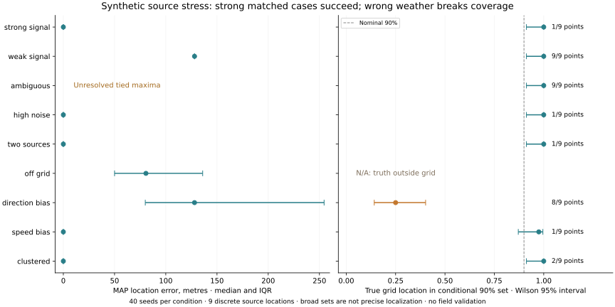
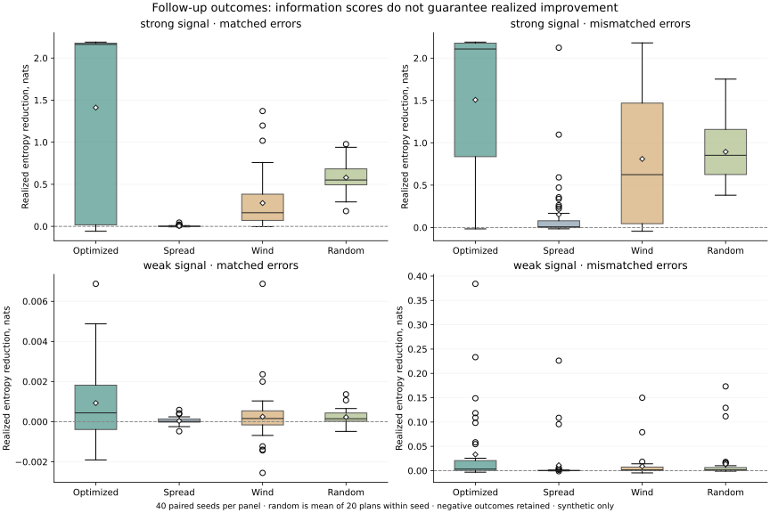

# UPWIND severe stress-test report

Scientific model **plume-ensemble-0.2.1**, protocol **UW-STRESS-2026-01**. Generated from recorded outcomes, not manually selected examples.

**Verdict:** the tested engineering contracts pass after specific defects were repaired. The source model does **not** have general scientific validity: weak signals, wrong weather, off-grid truth, unknown backgrounds and misreported uncertainty remain serious limitations. This is an experimental conditional model, not a perfectly coded or independently field-validated attribution system.

## What was actually executed

- **72,167 engineering/property checks**, zero failed groups: 71,017 numerical checks, 200 randomized placement instances and 50 capability/refusal checks. These are assertions/instances, not independent field datasets.
- **640 synthetic case/seed runs**: 16 conditions ×40 held-out seeds. Conditions share seeds; these are not 640 independent campaigns. Crashes: 0.
- **3,680 paired follow-up evaluations**: 40 seeds ×2 signal conditions ×2 error regimes ×23 methods (optimizer, spread, wind, 20 random seeds). Crashes: 0. These are 160 simulated worlds with repeated method comparisons, not 3,680 independent trials.
- **500 deterministic CSV edge combinations**, 64 writes using 32 client threads, malformed/oversized requests and integrity checks in isolated SQLite storage.
- **65,533 actual upstream hourly records inspected**, including 56,758 nonmissing PM2.5 readings. This is a measured-data audit and absent-coordinate refusal test, not a source-accuracy result.
- Separate regressions: 34 pytest tests; four Chromium investigation workflows; TypeScript/production build; Ruff undefined-name/unused-import checks. See recorded verification commands below.

## Defects exposed and corrected

| Finding | Correction / evidence |
|---|---|
| Empty site arrays crashed | Shape-safe vectorized predictions; a structured infeasible result, while scenario comparison remains available |
| Extreme uncertainty overflowed or produced singular covariance | Explicit supported per-reading range 0.01–1000 µg/m³; Cholesky solves instead of inverse; invalid schema rejected |
| Unmatched calm/variable weather was ignored | Check every relevant in-window local wind record before fit-row sampling |
| Row reduction could change represented sensors/conditions | Validate full window first; deterministic balanced quantiles retaining all supported sensors; maximum 40 fit rows/40 distinct sensors |
| Unsupported source/receptor pairs became misleading zeros | Refuse unsupported observation pairs; exclude unsupported candidates equally for all methods |
| Duplicate hypotheses/conflicting readings could distort evidence | ≥1m separation for source hypotheses; quarantine conflicting sensor/time groups; identical duplicates deduplicate without extra evidence |
| Site order changed geographic calculations | Stable coordinate origin and ID ordering; preserved initial development failures and successful randomized permutation checks |
| Subtracting large log determinants erased tiny information | Cholesky-whitened log1p eigenvalue score; independent singular-value oracle |
| Greedy could lose to a computed baseline | Large cases choose the best utility from greedy and the baseline envelope; no global-optimum or realized-benefit guarantee |
| Zero information was called infeasible | Separate uninformative status from permission/budget failure |
| Budget changed the coverage target universe | All permissible target sites remain in the objective, regardless of affordability; exact budget-monotonicity checks |
| Ambiguous MAP ties looked perfectly localized | Explicit tied MAP sets and min/max errors; no localization success claim for ties; earlier misleading scalar retained in the first run for audit |
| Residual alarm ignored supplied uncertainty | Covariance-whitened dimensionless RMS; previous diagnostic and its false alarms preserved in v0.2.0 outcomes |
| Malformed quotes/oversized Unicode could escape CSV contract | Strict CSV parsing, row-width checks, UTF-8 byte limit, preserved raw originals; 360° north normalization documented |
| Concurrent large requests lacked admission bound | Maximum four POST/PUT requests processing; overload gets explicit 429/Retry-After; reads remain available |

Baseline artifacts: `evaluations/stress/baseline-engine-0.1.0.py.txt`, `baseline-source-hashes.json`, `baseline-audit.json`, and `development-planning-failures.json`. The original 24-run v0.1 evaluation is unchanged. The first complete v0.2.0 stress run is retained beside the corrected final run. The evaluator/diagnostic amendments did not change emission/background grids, dispersion physics, likelihood weights or site objectives after inspecting held-out outcomes.

## Scientific outcomes — conditional synthetic evidence

| Case | Fits /40 | Median MAP error, m | Median 90% grid-set size | Truth in 90% set | Mismatch warnings |
|---|---:|---:|---:|---:|---:|
| weak_signal | 40 | 128.1 | 9 | 40/40 | 0 |
| strong_signal | 40 | 0.0 | 1 | 40/40 | 0 |
| ambiguous | 40 | Unresolved ties | 9 | 40/40 | 0 |
| high_noise | 40 | 0.0 | 1 | 40/40 | 0 |
| background_shift | 40 | 0.0 | 1 | 40/40 | 0 |
| changing_background | 40 | 0.0 | 1 | 40/40 | 40 |
| two_sources | 40 | 0.0 | 1 | 40/40 | 0 |
| off_grid | 40 | 80.6 | 8 | N/A | 0 |
| direction_bias | 40 | 128.1 | 8 | 10/40 | 0 |
| speed_bias | 40 | 0.0 | 1 | 39/40 | 0 |
| clustered | 40 | 0.0 | 2 | 40/40 | 0 |
| missing_sensor | 40 | 0.0 | 1 | 40/40 | 0 |
| calm | 0 | Refused | N/A | N/A | 0 |
| variable | 0 | Refused | N/A | N/A | 0 |
| missing_weather | 0 | Refused | N/A | N/A | 0 |
| insufficient_sensors | 0 | Refused | N/A | N/A | 0 |

The matched high-signal demonstration meets its predeclared expectation: **40/40** unique MAP estimates within 100m, versus **6/40** for weak signals. This deliberately favorable high-signal generator uses the same dispersion family with an independently coded scalar implementation; it is not independent atmospheric validation. Weak/upwind data can retain nearly the entire 9-point grid, so including truth in a large set is not useful localization.

Ambiguous upwind cases have tied maxima: their legacy first-index scalar error can be zero solely because truth is listed first. They are unresolved, not successful. Off-grid truth has no meaningful coverage under the on-grid discrete set; its coverage is N/A. Wind bias can exclude the real source even while retaining a broad-looking set. Sharp single-source fits to multi-source/changing-background data do not validate the single-source assumption. A missing residual alarm does not establish correctness.

Confidently wrong unique grid choices: **1** (>90% conditional weight on a nontruth grid location) in the scientific battery. Exact 100m boundaries use metre-level interpretation rather than treating floating-point 100.0000000001 as a substantive distance above 100m. The original raw distance-threshold boolean is retained for audit and is not used as the primary count.

The constructed two-source condition triggered **0/40** residual alarms. Failure to detect an unmodelled second source is a retained scientific limitation; a correct dominant-grid location does not establish that only one source exists.

Concrete failure: `speed_bias`, seed `220023`, error **100.0m**, conditional maximum weight **97.70%**, mismatch alarm **False**.

## Realized follow-up benefit, including failures

Plans are locked before candidate outcomes are generated/revealed. Every method sees the same budget/opportunities and the same candidate error realization within a seed. Random methods are averaged **within seed** before paired comparisons. Matched means a matched synthetic covariance family, not exact planner expected-information optimality. The mismatch deliberately adds stronger/longer-range error and underreported independent noise.

| Signal / error regime | Method | Mean entropy reduction, nats | Mean location error, m | Mean held-out predictive RMSE, µg/m³ | Wrong grid with >90% weight |
|---|---|---:|---:|---:|---:|
| strong_signal / matched | Optimized | 1.4115 | 25.57 | 4.09 | 0/40 |
| strong_signal / matched | Spatial | 0.0037 | 165.47 | 8.55 | 0/40 |
| strong_signal / matched | Wind | 0.2770 | 47.98 | 6.52 | 0/40 |
| strong_signal / matched | Random | 0.5796 | 81.64 | 6.35 | 0/800 |
| strong_signal / mismatched | Optimized | 1.5074 | 42.31 | 6.58 | 3/40 |
| strong_signal / mismatched | Spatial | 0.1523 | 148.50 | 10.04 | 1/40 |
| strong_signal / mismatched | Wind | 0.8092 | 75.72 | 7.48 | 2/40 |
| strong_signal / mismatched | Random | 0.8939 | 90.55 | 8.35 | 55/800 |
| weak_signal / matched | Optimized | 0.0009 | 154.14 | 1.53 | 0/40 |
| weak_signal / matched | Spatial | 0.0000 | 151.03 | 1.54 | 0/40 |
| weak_signal / matched | Wind | 0.0002 | 138.55 | 1.54 | 0/40 |
| weak_signal / matched | Random | 0.0002 | 151.61 | 1.54 | 0/800 |
| weak_signal / mismatched | Optimized | 0.0334 | 173.48 | 3.98 | 0/40 |
| weak_signal / mismatched | Spatial | 0.0111 | 160.50 | 3.83 | 0/40 |
| weak_signal / mismatched | Wind | 0.0090 | 185.74 | 4.19 | 0/40 |
| weak_signal / mismatched | Random | 0.0136 | 166.51 | 3.95 | 0/800 |

Paired seed-level comparisons (Wilson intervals describe Monte Carlo win rates, not real-world calibration):

- strong_signal / matched: optimizer entropy advantage over the random-seed mean **0.8319 nats**; wins **27/40** (95% Wilson 0.52–0.80); 6 runs increased entropy; 13 had worse predictive RMSE than the random-seed mean.
- strong_signal / mismatched: optimizer entropy advantage over the random-seed mean **0.6135 nats**; wins **30/40** (95% Wilson 0.60–0.86); 3 runs increased entropy; 14 had worse predictive RMSE than the random-seed mean.
- weak_signal / matched: optimizer entropy advantage over the random-seed mean **0.0007 nats**; wins **24/40** (95% Wilson 0.45–0.74); 14 runs increased entropy; 16 had worse predictive RMSE than the random-seed mean.
- weak_signal / mismatched: optimizer entropy advantage over the random-seed mean **0.0197 nats**; wins **27/40** (95% Wilson 0.52–0.80); 8 runs increased entropy; 16 had worse predictive RMSE than the random-seed mean.

**Interpretation:** the optimizer helps in the matched high-signal synthetic setting, but there is no general improvement guarantee. Weak-signal mean localization/prediction can be worse than random. Under mismatch, confidence can increase while accuracy deteriorates. Entropy reduction is neither a health benefit nor evidence of the correct source. Negative and worse-than-baseline outcomes are retained.

## Capacity, robustness and actual hardware

CPU: **AMD EPYC 9V45 96-Core Processor**. Python 3.12.14; NumPy 2.3.5; Linux-6.18.55-x86_64-with-glibc2.41. One sequential Python process, BLAS threads pinned to 1. Full evaluation wall time: 16.73s. These timings characterize this machine, not every laptop.

| Measurements | Weather records | Sites / source hypotheses | Fit rows | Wall ms | Peak RSS MiB (Linux VmHWM) |
|---:|---:|---|---:|---:|---:|
| 100 | 100 | 100 / 25 | 40 | 97.38 | 76.36 |
| 1,000 | 1,000 | 100 / 25 | 40 | 155.69 | 84.56 |
| 5,000 | 5,000 | 100 / 25 | 40 | 563.70 | 144.42 |
| 10,000 | 10,000 | 100 / 25 | 40 | 1416.28 | 227.01 |

Each scale case ran in a subprocess with a 30s timeout and 2GiB address-space ceiling. Linux VmHWM reports the fresh executable's high-water RSS; `getrusage` may include inherited launcher accounting and is retained separately. Incremental high-water growth of zero does not mean no memory allocation. Ten thousand imported/validated rows **does not mean ten thousand rows fitted**: inference uses a declared 40-row balanced subset after all-window checks. Memory/resource instrumentation is verified on Linux, not every supported laptop OS.

Concurrency results: {'200': 18, '429': 46}. All 18 acknowledged writes were present exactly once; rejected overload writes were not claimed saved. All malformed requests returned 422, oversized body returned 413, invalid writes left storage unchanged, and a request after overload succeeded. 429 is deliberate capacity refusal, not silent success or an unexplained server crash.

## External data evidence and remaining blockers

Actually inspected: **openair mydata / London Air Quality Archive, Marylebone station**, revision `c2970d8c5addf68497bddaae13230167e7387651`, SHA256 `f40da24c7855076874d04dfc13e612d53313d029fe3c24692bff73d19d92fc38`. 65,533 rows; 56,758 PM2.5 observations and 8,775 missing. Median 20.0 and maximum 398.0 µg/m³.

Coordinates are absent; all incomplete spatial imports were rejected rather than supplied invented coordinates. One urban station and no known release truth cannot validate this source model. Official NOAA/EPA/UCI/UK station-metadata acquisition remained blocked by CONNECT 403; those datasets were not evaluated. Raw upstream observations remain ignored locally pending primary-data redistribution review. See [DATASET_CATALOG.md](DATASET_CATALOG.md) for compatible uses and rejected assumptions.

## Reproduction and next decisions

```sh
uv pip install --python .venv/bin/python -r requirements-research.lock
OPENBLAS_NUM_THREADS=1 OMP_NUM_THREADS=1 .venv/bin/python -m upwind.validation.run --out .local/new-stress-run
.venv/bin/python -m upwind.validation.reporting --input .local/new-stress-run --out .local/new-stress-report.md
.venv/bin/python -m pytest -q
cd frontend
npm run build
npm run test:e2e
```

Raw final results: `evaluations/stress/v0.2.1-final` (`metadata`, `engineering`, `science`, `followup`, `resources`, `external`, `api`, `summary` JSON). Metadata hashes identify the exact numerical/evaluation sources and protocol. Previous outputs are never overwritten by the runner. Repeating frozen seeds verifies a correction; it is not new independent evidence.

Next priorities follow the failures: acquire compatible controlled-release data and verified station metadata; validate units/heights and reject mismatched campaigns; test independent campaign/site/time splits; quantify weather/background/model discrepancy with real evidence; independently evaluate forecast/scheduling before enabling it; observe an actual operator. Do not tune the current held-out seeds or market conditional source weights as field probabilities. No outreach, public deployment, Git push or data publication was performed by this stress task.

## Recorded-data figures





Figures are generated by `scripts/plot_stress.py`; its input/source hashes and plotting-library version are in `figures.json`.
