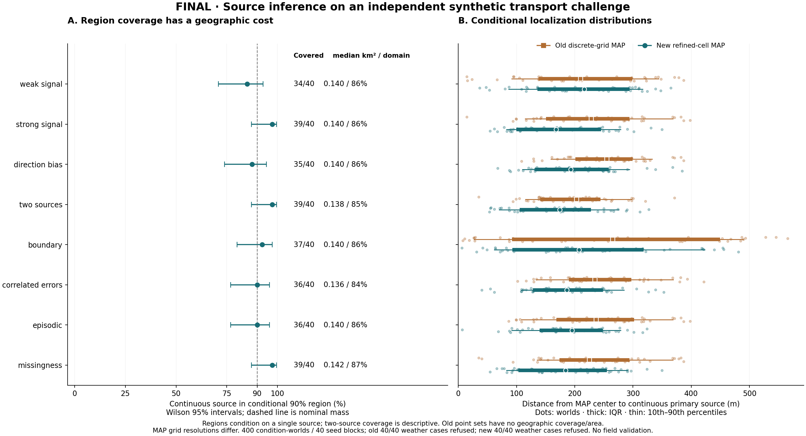
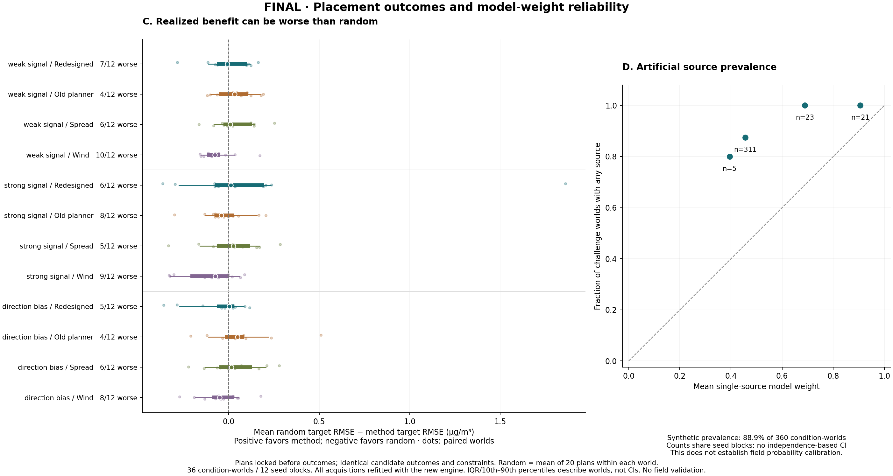

# Overhaul figures — FINAL

These figures display the recorded final split. They do not run or tune inference. Development and calibration figures are not final evaluation evidence.

The left panel pairs continuous-region coverage with Wilson 95% intervals and median area/domain fraction. Regions condition on a single source; coverage for a two-source world is descriptive under a false model. The old engine's discrete point set has no asserted geographic area or off-grid coverage. The right panel compares distance to the continuous primary source using the old discrete-grid MAP and new refined-cell MAP: grid resolutions differ. Every light dot is one retained source-containing world, with median/IQR and 10th–90th percentile summaries. Background-only worlds have no source to localize; unsupported and failed cases remain in the source JSON/summary denominators.

Positive target-RMSE differences favor the stated method; negative differences favor the mean of 20 random plans within the same world. The labels retain the worsened-world counts. These are paired condition-worlds sharing seed blocks, not 20 independent random campaigns. Old/new denotes acquisition algorithms; all outcomes are refitted with the same redesigned engine. The source-model reliability plot has artificial prevalence and counts any source (including two-source worlds). Because pooled bins share seed blocks across conditions, no independence-based intervals are plotted. It does not establish field calibration or responsibility probabilities; the diagonal is a reference, not an empirical guarantee.

Inputs: `evaluations/overhaul/new-final`. Protocol: `UW-OVERHAUL-2026-01`. Code-stability field recorded by evaluation: `True`. Exact plot values, input/script hashes, dependency metadata hashes and output hashes are in `figures.json`. No measured-data validation was performed.
